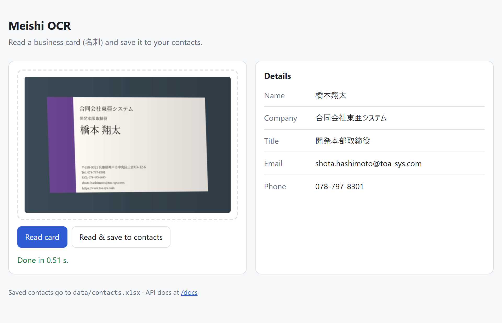

# Meishi OCR CRM

[](https://github.com/agrawaladitya270/Meishi-crm/actions/workflows/ci.yml)
[](pyproject.toml)
[](LICENSE)

Reads **name, company, title, email and phone** from photos or scans of Japanese and English
business cards (名刺), and saves them to an Excel contacts sheet. Runs on CPU with open-source
models (OpenCV + PaddleOCR), no paid APIs.

<picture>
  <source media="(prefers-color-scheme: dark)" srcset="docs/ui-dark.png">
  
</picture>

- **93.9% field accuracy** on 150 held-out test cards, up from 84.0% with the previous Tesseract pipeline
- **Sideways and upside-down photos work**: the card is found, flattened and turned upright first
- About 2 s per card on CPU
- Web upload page, JSON API, and a contacts sheet that updates existing rows instead of adding duplicates
- Docker image, and CI that fails the build if accuracy drops below 80% (upright or sideways)

## How it works

```
photo ──► apply the phone's rotation tag ──► find the card (brightness, then edges) + flatten perspective
      ──► turn it upright (PaddleOCR orientation model) ──► fix lighting ──► PaddleOCR PP-OCRv5 (ja + en)
      ──► lines with size + confidence ──► field rules ──► (optional local LLM fill) ──► JSON / Excel
```

## Quick start

**Docker** (easiest; the models are baked into the image)

```bash
docker compose up --build
```

**Local** (Linux, macOS or Windows)

```bash
pip install -r requirements.txt
uvicorn meishi.api:app --port 8000
```

Then open **http://localhost:8000**. The OCR models (about 27 MB) download on the first request.

<details>
<summary>Optional: Tesseract (only for <code>reader="tesseract"</code> and the v0–v6 comparisons in <code>eval/</code>)</summary>

```bash
sudo apt-get install tesseract-ocr tesseract-ocr-jpn        # Linux
brew install tesseract tesseract-lang                       # macOS
```

Windows (PowerShell): the installer ships English only, so add the Japanese data yourself:

```powershell
winget install UB-Mannheim.TesseractOCR
$td = "$env:LOCALAPPDATA\tessdata"; New-Item -ItemType Directory -Force $td | Out-Null
Copy-Item "C:\Program Files\Tesseract-OCR\tessdata\*.traineddata" $td
Invoke-WebRequest -UseBasicParsing https://github.com/tesseract-ocr/tessdata_fast/raw/main/jpn.traineddata -OutFile "$td\jpn.traineddata"
# in each new terminal:
$env:PATH = "C:\Program Files\Tesseract-OCR;" + $env:PATH
$env:TESSDATA_PREFIX = "$env:LOCALAPPDATA\tessdata"
```
</details>

## Use it

**In the browser:** open http://localhost:8000, drop in a card image (or paste one), and click
**Read card** or **Read & save to contacts**. Fields that could not be found are flagged for review.

**Through the API:**

| Endpoint | What it does |
|---|---|
| `POST /extract` | Image in, fields out as JSON |
| `POST /contacts` | Same, and saves the contact to the Excel sheet. A row with the same email or phone is updated, not duplicated |
| `GET /health` | Status and version |
| `GET /docs` | Interactive API docs |

```bash
curl -F "file=@samples/scan_en.jpg" localhost:8000/extract
```

```json
{
  "fields": {
    "Name": "Tomoko Suzuki",
    "Company": "Hikari Denshi Inc.",
    "Title": "Marketing Dept. Senior Engineer",
    "Email": "suzuki@hikari-d.com",
    "Phone": "+81-52-895-6146"
  },
  "confidence": {"Name": 0.915, "Company": 0.917, "Title": 0.92, "Email": 0.925, "Phone": 0.915},
  "needs_review": [],
  "seconds": 0.506
}
```

Images can be up to 10 MB. Settings are environment variables:

| Variable | Default | Meaning |
|---|---|---|
| `MEISHI_CONTACTS` | `data/contacts.xlsx` | Where contacts are saved |
| `MEISHI_MODEL_DIR` | `~/.cache/meishi` | Where the orientation model is stored |
| `MEISHI_LLM` | `off` | `on` lets a small local LLM fill fields the rules missed. Needs `pip install transformers torch accelerate` |
| `MEISHI_LLM_MODEL` | `Qwen/Qwen2.5-1.5B-Instruct` | Model used when `MEISHI_LLM=on` |

## Results

Test set: **150 synthetic cards** (half clean scans, half phone-photo style), never used for tuning.
Rules and settings were tuned on a separate 60-card dev set. Field scoring is strict (see
`eval/run_eval.py`): exact match after Unicode normalization; phone = same digits.

### Current pipeline (measured on Windows, Yu Gothic / MS Gothic fonts)

| Step | Mean field accuracy | All 5 fields right | Photos | Scans | Cards turned 90° | Median time |
|---|---|---|---|---|---|---|
| v4 — Tesseract (previous default) | 84.0% | 45.3% | 78.0% | 89.2% | 0.0% | 0.48 s |
| v6 — + orientation model | 84.0% | 45.3% | 78.0% | 89.2% | — | 0.69 s |
| **v7 — + PaddleOCR PP-OCRv5 reader (default)** | **93.9%** | **76.0%** | **87.7%** | **99.3%** | **92.9%** | **2.21 s** |

Per field (v7): name 99.3%, phone 97.3%, company 94.7%, title 90.7%, email 87.3%.
The orientation model alone turned all 240 dev cards (60 cards × 0°/90°/180°/270°) the right way up.

### Earlier steps (measured on Linux, Noto CJK / IPA fonts)

The fonts differ, so compare rows within one table, not across tables (v4 scores 87.6% here, 84.0% above).

| Step (each row adds one change) | Mean field accuracy | Cards with all 5 fields right | Photos | Scans |
|---|---|---|---|---|
| v0 — original notebook (Tesseract defaults + first rules) | 47.7% | 9.3% | 31.6% | 63.4% |
| v1 — new field parser | 69.2% | 32.7% | 51.9% | 86.1% |
| v2 — + card detection and perspective correction | 79.9% | 42.7% | 72.4% | 87.1% |
| v3 — + lighting correction | 81.2% | 40.0% | 75.4% | 86.8% |
| v4 — + upscaling to 1200 px and Tesseract layout mode 4 | 87.6% | 55.3% | 83.2% | 91.8% |

### What the parser fixes
- The original rules took the **postal code as the phone number** and **department names as the
  person's name**. The phone parser now reads the labels (TEL / 電話 / FAX / 携帯 / Mobile), skips FAX,
  and validates digit counts.
- OCR puts spaces between Japanese characters (`山 田 太 郎`); text is NFKC-normalized and those
  spaces are removed.
- The name is chosen as the **tallest** name-like line (names are the biggest text on a card).
  Hiragana-only text (usually a misread logo) is not taken as a name.
- Emails are repaired for common OCR damage: commas for dots, spaces inside the address, `.cojp`.
- A misread 株式会社 (株式雲社, 株式亡社) is repaired: no other character fits there.

### Findings that changed the design
- **Tesseract's layout analysis merges text that sits side by side.** On a real phone photo it glued a
  department name onto the person's name and misread the company. PaddleOCR reads each phrase
  separately; phrases of the same size in the same row are joined back together.
- **docTR was tried and dropped.** Its text detector, trained mostly on European-language documents,
  missed Japanese words such as 株式会社 (company accuracy fell to about 30%), and its page-orientation
  model flipped 10 of 60 upright cards. PaddleOCR's orientation model made no mistakes on the same cards.
- **OCR confidence does not predict correctness.** On the dev set, precision of auto-accepted fields
  stayed at ~93% whatever the confidence threshold, so confidence-based auto-approval was dropped.
  Only fields the rules could not find are flagged for review (also when the LLM fills them in).
- **Upscaling helps small text but hurts the big name text** (Tesseract). A second OCR pass at native
  size for the name is available as `Config(name_pass=True)` but off by default.

### Limits — read before quoting these numbers
- The cards are **synthetic** (generated with real Japanese fonts and realistic noise). Real cards
  have logos, vertical text and unusual layouts. So far one real phone photo has been checked (all
  four fields on it read correctly). Add your own real cards to `data/real/` with `labels.jsonl` in
  the same format and run the same script; `data/` is never committed.
- Vertical text (縦書き) cards are not supported yet.
- The optional LLM fallback (`MEISHI_LLM=on`) is **not** included in the numbers above.

## Evaluate

```bash
python eval/gen_cards.py --out data/dev  --n 60  --seed 1 --split dev
python eval/gen_cards.py --out data/test --n 150 --seed 2 --split test
python eval/run_eval.py --data data/test --configs v4 v6 default --out results/test_v7.json
python eval/run_eval.py --data data/test --configs default --rotate 90    # sideways photos
```
The test split uses different seeds and includes titles, departments, companies and cities that
never appear in the dev split. CI regenerates 40 cards and fails the build if mean field accuracy
drops below 80%, upright or turned 90°.

## Development

```bash
pip install -r requirements-dev.txt
ruff check .
pytest -q
```

## Project layout

```
meishi/   ocr.py (card detection, orientation, lighting, PaddleOCR and Tesseract readers)
          parse.py (field rules) · pipeline.py · baseline.py (original v0 logic, for comparison)
          llm.py (optional) · store.py · api.py · ui.html (upload page)
eval/     gen_cards.py (synthetic dataset) · run_eval.py (metrics, ablations, CI gate)
tests/    parser unit tests, API tests
results/  saved evaluation runs (dev and test)
docs/     screenshots
```

## License

[MIT](LICENSE) © 2026 Aditya Agrawal
